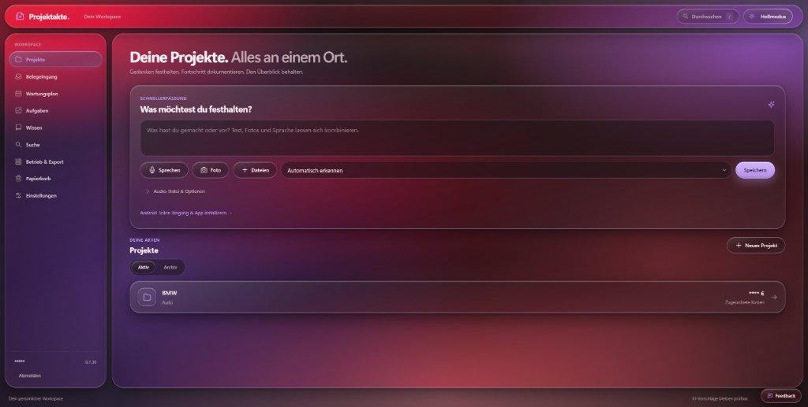

# Projektakte

**Capture on the go in seconds, plan and verify calmly at your desk.**

Projektakte is a self-hosted project logbook for vehicles, home projects, repairs, and long-running builds. On your phone, you throw in a quick text note, photo, PDF, or voice memo without stopping what you are doing; optional AI and OCR pre-structure the draft in the background, and later on desktop you review and confirm every cost or entry following a strict **suggestions instead of blind auto-booking** (human-in-the-loop) workflow.

> **Languages, Currency & Timezone:** Projektakte is fully bilingual (**English & German**) with automatic browser language detection, an in-app switcher, and language-aware AI suggestions. Currency (`DEFAULT_CURRENCY`) and timezone (`TIME_ZONE` / `TZ`) are configurable for international self-hosters.

---

## Key Features

- **Mobile Capture-First:** On smartphones, the quick-capture box (text, microphone recording, camera photo, file upload, optional project auto-detection) opens immediately in the first viewport without scrolling; navigation stays tucked into the top bar until needed.
- **Projects & Chronicle:** Structured timelines per project with categories, custom fields, work steps, annotated before/after photos, optimistic locking, and reversible trash.
- **Parts & Maintenance Tracking:** Track spare parts separately from actual installation events (buying a part does not auto-log an installation), plus recurring maintenance schedules based on time intervals and/or meter readings (e.g. km, operating hours).
- **Receipt Inbox & Human-in-the-Loop AI:** Review invoices and receipts side-by-side with the original PDF/image and OCR text, split a single receipt across multiple projects or entries, and confirm once without double-counting. Optional integrations for **Paperless-ngx**, **Google Gemini**, and **IMAP** mail import.
- **Knowledge Base & Repair Library:** Store notes, torque specs, chunked work videos, and structured operator-supplied repair manuals with search.
- **Exports & Verified Backups:** Generate compact or photo-rich PDF reports and portable ZIP exports, alongside consistent SQLite + media backups with SHA-256 manifests.

---

## Screenshots

<!-- Drop your demo screenshots into docs/screenshots/ using the filenames below. -->

| Mobile Capture-First | Desktop Workspace |
| --- | --- |
|  |  |

---

## Architecture at a Glance

Projektakte is intentionally built as a lean, self-contained **Django monolith** designed for data sovereignty and modest hardware such as a **Raspberry Pi 4 (2 GB RAM)**:

- **Stack:** Python 3.14, Django 5.2, SQLite (`IMMEDIATE` transactions + shared OS write gate), Waitress WSGI, WhiteNoise, `nh3` (Rust HTML sanitizer), and HTMX.
- **No JS build pipeline:** Plain CSS and vanilla JavaScript—no Node.js, Webpack, or SPA bundler required to build or run.
- **Two processes, one image:** `web` serves HTTP/HTML and static assets; a single serial `worker` handles background jobs (OCR sync, AI extraction, thumbnails, IMAP polling, exports, backups) via database leases.
- **Fast on low-power hardware:** GZip compression, immutable static caching, and a volatile in-memory browser tab shell (`instant-shell.js`) keep page transitions snappy without storing your database in the browser.

---

## Quickstart with Docker Compose

Prebuilt multi-architecture images (`linux/amd64` and `linux/arm64` for Raspberry Pi) are published to GitHub Container Registry (`ghcr.io/nbf207/projektakte`). No local build or repository clone is required.

### 1. Minimal First Start (Local / LAN)

Download `compose.yaml` and `.env.example`, copy `.env.example` to `.env`, and start:

```sh
cp .env.example .env
docker compose up -d
```

*(PowerShell: `Copy-Item .env.example .env`)*

On first start, the `web` container automatically:
1. Generates a persistent random secret key inside the `/data` volume (`/data/.secret-key`) if `SECRET_KEY` is left empty.
2. Runs database migrations safely before accepting traffic (with `worker` waiting until `web` is healthy).

Open [http://127.0.0.1:8010/](http://127.0.0.1:8010/)—with zero users in the database, you are redirected to the one-time `/setup/` page to create your admin account directly in the browser. Once created, `/setup/` is permanently disabled (`404`).

### 2. Enable Optional Integrations Anytime Later

AI (Google Gemini), Paperless-ngx, IMAP mail import, and reverse-proxy HTTPS are all **optional**. You can start clean and enable any of them later without reinstalling or touching your data: edit `.env` and run `docker compose up -d`.

### 3. Safe Updates & Rollback

```sh
docker compose pull
docker compose up -d
```

Whenever a new version includes database migrations, Projektakte automatically verifies SQLite integrity and saves a consistent pre-migration snapshot to `/data/backups/pre-migrate/` before migrating. If you ever need to roll back, pin the previous image tag in `compose.yaml` and restore the snapshot via `python manage.py rollback_db --restore latest`.

### 4. Building Locally or Running on Raspberry Pi

- **Local build from source:** `docker compose -f compose.yaml -f deployment/compose-build.yaml up -d --build`
- **Raspberry Pi limits & secret mounts:** `docker compose -f compose.yaml -f deployment/compose-pi.example.yaml up -d`
- **Local synthetic demo:** Set `DEMO_MODE=1` in `.env`, run `docker compose run --rm --no-deps web python manage.py seed_demo`, and sign in as `demo` / `Projektakte-Demo-2026!`.

See the full [Self-Hosting & Operations Guide](docs/SELF-HOSTING.md) for reverse-proxy/TLS setup, integrations, backups, and rollback details.

---

## Documentation

- **[User Guide](docs/USER-GUIDE.md)** — Daily workflows: quick capture, chronicle, receipt review, maintenance schedules, parts, knowledge base, PWA/Android sharing, and exports.
- **[Self-Hosting & Operations Guide](docs/SELF-HOSTING.md)** — Production Docker deployment, Raspberry Pi tuning, reverse proxy & security model, integrations, backups, restore verification, and updates.
- **[Optional Deployment Templates](deployment/README.md)** — Raspberry Pi resource limits, secret file mounts, and optional update-guard examples.

---

## Development Note

Large parts of this project—including architecture iterations, backend features, security hardening, and UI polish—were built with AI coding assistance, primarily using **6.1 Sol**, **6 Astra**, **6.2 Sol**, and **4 Neon**. Core workflows were tested on a self-hosted Raspberry Pi 4.

---

## License

Projektakte is licensed under the **GNU Affero General Public License v3.0 (AGPL-3.0)**. See [LICENSE](LICENSE) for the full license text.
