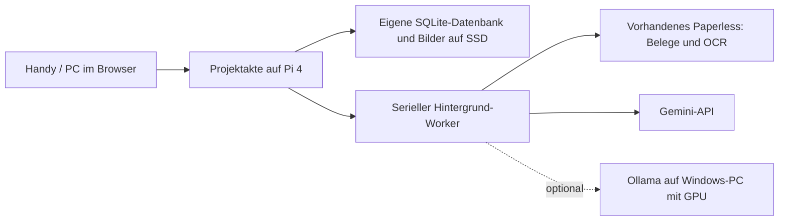

# Projektakte – vollständiger Produkt- und Umsetzungsplan

Stand: 12. November 2026, Europe/Berlin. Arbeitstitel: **Projektakte**.

Dieses Dokument beschreibt die geplante Anwendung. Es ist die Grundlage für die Entwicklung; die Anwendung wurde damit noch nicht installiert oder umgesetzt. Der zugehörige [Umsetzungsbacklog](UMSETZUNGSBACKLOG.md) enthält die Reihenfolge und die prüfbaren Ergebnisse der Arbeitspakete.

Für die Weitergabe an einen Entwickler oder eine andere KI gibt es eine [eigenständig lesbare Übergabe](README.md). Ihr Entwicklerauftrag präzisiert den Umfang der ersten Version, Standardentscheidungen und Fachregeln; Bedienbeispiele und synthetische Testdaten machen die Erwartungen überprüfbar. Das ZIP-Paket enthält portable Kopien dieses Plans und des Backlogs.

## 1. Ziel und bereits getroffene Entscheidungen

Eine persönliche, im Browser nutzbare Projektverwaltung für Auto, Aquarium, Drohne und spätere Hobbys. Kurze Formulare erzeugen eine einheitliche Chronik. Größere Umbauten erscheinen dort in einer einzigen aufklappbaren Zeile und besitzen dahinter eine ausführliche Dokumentation mit Arbeitsschritten und Bildern.

Verbindliche Grundlage aus unserem Gespräch:

- Betrieb der Projektverwaltung auf dem vorhandenen Raspberry Pi 4.
- Bedienung am PC und am Handy, besonders für Fotos und kurze Einträge.
- Eigene Projektakten mit technischen Daten, Wartungen, Reparaturen und Umbauten.
- Ölwechsel schnell mit Datum, Kilometerstand, Ölsorte und Kosten erfassen.
- Rechnungen fotografieren oder als Datei hinzufügen und einem Projekt/Vorgang zuordnen.
- Bestehendes Paperless-ngx für OCR und Belegarchiv verwenden.
- Gemini-API als bevorzugte KI-Anbindung. Kontotyp und Abrechnung werden vom Betreiber festgelegt.
- KI-Ergebnisse vor Übernahme nachvollziehbar anzeigen und korrigierbar halten.
- Lokale KI auf einem separaten, ausreichend ausgestatteten Rechner als spätere Alternative.
- Daten übersichtlich anzeigen, schnell suchen und ohne manuelles Formatieren ergänzen.

Die weiteren Funktionen dieses Plans sind konkrete Entwurfsvorschläge. Die Tabellen mit Prioritäten und offenen Punkten zeigen, was für die erste Version vorgesehen ist und was erst später ergänzt wird.

## 2. Vorhandene Umgebung und Konsequenzen

Grundlage sind vorhandene lokale Serverprotokolle vom 11. November 2026, keine neue Live-Prüfung des Pi:

| Vorhandener Stand | Konsequenz für die Planung |
|---|---|
| Pi 4, 2 GB physischer RAM, Debian 13/ARM64, zahlreiche laufende Container | Kleine Anwendung, begrenzte Parallelität und Lastmessung vor Freigabe. |
| Anwendungsdaten auf SSD; Betriebssystem auf SD-Karte | Neue Datenbank, Bilder und Dateien auf die bestehende SSD legen. |
| Paperless-ngx 3.4.2 mit SQLite und eigenem Broker | Bestehende Instanz über ihre unterstützte API nutzen. |
| Deutsche/englische OCR und PDF-/Bildverarbeitung eingerichtet | Vorhandene OCR übernehmen; Verarbeitung nicht doppelt aufbauen. |
| Paperless verarbeitet einen Auftrag/eine OCR-Seite gleichzeitig | Neue Aufträge in eine Warteschlange stellen und Fortschritt anzeigen. |
| Docker-RAM-Limits im dokumentierten Kernelzustand unwirksam | Keine Schutzwirkung durch ein bloßes `mem_limit` versprechen; Hostlast und Prozesse tatsächlich messen. |
| WUD und Sicherungs-/Update-Guard vorhanden | Neue Anwendung gezielt in diesen Ablauf aufnehmen. |
| Regelmäßige unabhängige Sicherung von Paperless nicht bestätigt | Gemeinsame Sicherungs- und Wiederherstellungsstrategie für Projektakte und Paperless einplanen. |
| Homepage, Vikunja und BookStack vorhanden | Homepage-Verknüpfung ergänzen; spätere Integrationen ermöglichen. |

Betriebsbasis: [Zusammenfassung der vorhandenen Umgebung](README.md#ausgangsumgebung). Die privaten Originalprotokolle werden für die Entwicklung nicht benötigt.

Vor der Installation werden Versionen, freier Speicher, tatsächliche RAM-/CPU-Last und belegte Ports erneut geprüft. Bestehende Protokolle ersetzen diesen Schritt nicht.

## 3. Aufbau der Oberfläche

Die Oberfläche ist deutsch und für schmale Handybildschirme sowie PC ausgelegt. Datum und Zahlen verwenden deutsche Darstellung, Geldbeträge eine ausdrücklich gespeicherte Währung. Die Standardzeitzone ist Europe/Berlin.

### Globale Navigation

1. **Übersicht:** Projektkacheln, letzte Aktivitäten, fällige Aufgaben, wartende Belege.
2. **Projekte:** aktive und archivierte Projekte, Filter und Favoriten.
3. **Eingang:** neue Belege, schnelle Notizen, Entwürfe, unvollständige KI-Vorschläge.
4. **Aufgaben:** projektübergreifende Liste, Fälligkeiten und wiederkehrende Arbeiten.
5. **Suche:** gemeinsame Suche mit Filtern.
6. **Einstellungen:** Vorlagen, Felder, Anbindungen, KI-Verbrauch, Export und Sicherungsstatus.

Am Handy ist „Hinzufügen“ jederzeit leicht erreichbar. Es öffnet die Auswahl Wartung, Reparatur, Umbau, Rechnung, Foto, Messwert oder Notiz. Im geöffneten Projekt ist das Projekt bereits vorausgewählt.

### Innerhalb eines Projekts

**Überblick · Chronik · Umbauten · Ausstattung/Teile · Dokumente · Aufgaben · Messwerte**

Nur eingeschaltete Bereiche werden angezeigt. Ein Aquarium benötigt beispielsweise keine Kilometer-Spalte. Technische Pflichtfelder werden auf das notwendige Minimum beschränkt; Entwürfe dürfen unvollständig sein.

## 4. Projekte, Vorlagen und Stammdaten

Ein Projekt besitzt Name, Typ, Titelbild, Beschreibung, Status, Tags und Favoritenmarkierung. Status: aktiv, pausiert, abgeschlossen oder archiviert. Archivierung erhält Suche, Historie und Exporte.

Vorlagen liefern passende Felder und Eingabearten:

| Vorlage | Beispielhafte Stammdaten | Laufende Daten |
|---|---|---|
| Auto | Hersteller/Modell, Baujahr, Motor, FIN, Öl-Spezifikation, Reifen | Kilometerstand, Wartung, Reparatur, Umbau |
| Aquarium | Volumen, Maße, Technik, Besatz, Sollbereiche | Wasserwerte, Wasserwechsel, Düngung, Technikwechsel |
| Drohne | Rahmen, Motoren, Flugcontroller, Firmware, Akkus | Reparaturen, Einstellungen, optional Flüge und Akkuzyklen |
| Freies Projekt | Selbst definierte technische Angaben | Notizen, Arbeiten, Teile, Dokumente, eigene Messwerte |

Eigene Felder unterstützen Text, mehrzeiligen Text, Zahl, Datum, Auswahl, Ja/Nein und Link; Zahlen können eine Einheit besitzen. Vorlagenänderungen verändern bestehende historische Einträge nicht rückwirkend. Felder lassen sich ausblenden oder stilllegen, ohne alte Werte zu löschen.

Die eingebaute Ausstattung ist sowohl als heutiger Zustand als auch historisch nachvollziehbar. Ein ausgebautes Teil wird als ausgebaut markiert; seine früheren Einbauten bleiben erhalten.

## 5. Chronik und aufklappbare Vorgänge

Jeder eigenständige Vorgang erscheint genau einmal in der Hauptchronik:

| Datum/Zeitraum | Vorgang | Zähler | Status | Kosten | Anhänge |
|---|---|---|---|---|---|
| 12.11.2026 | ▸ Ölwechsel | 165.200 km | Erledigt | 75,00 EUR | 1 Beleg |
| 01.–12.11.2026 | ▸ Soundsystem-Umbau | optional | Abgeschlossen | 1.250,00 EUR | 12 Bilder, 3 Belege |

Die Zeilen sind ausschließlich erfundene Bedienbeispiele.

Ein Klick bzw. Tippen öffnet eine Vorschau direkt unter der Zeile. Für ausführliches Lesen und Bearbeiten gibt es zusätzlich „Details öffnen“ mit eigener, direkt verlinkbarer Seite. Maus und Tastatur funktionieren ebenso wie Touchbedienung.

Regeln:

- Arbeitsschritte eines Umbaus erscheinen innerhalb seines Vorgangs; sie erzeugen keine zusätzlichen Hauptzeilen.
- Die Suche findet auch Inhalte eingeklappter Vorgänge und springt an die passende Stelle.
- Anhänge und Kostenanzahlen werden automatisch zusammengefasst.
- Filter: Vorgangsart, Datum, Status, Tag, Bauteil und Projekt; Sortierung nach Chronikdatum, Zähler oder Kosten.
- Ein Umbau zeigt Beginn und Ende. Sein Chronikdatum ist zunächst der Beginn und kann ausdrücklich geändert werden. Nachträgliche Bild-Uploads verschieben ihn nicht automatisch.
- Rechnungsdatum, tatsächliches Arbeitsdatum, Erfassungsdatum und optionale Bildaufnahmezeit sind unterschiedliche Angaben.
- Unbekanntes Datum oder nur Monat/Jahr ist zulässig und wird sichtbar so gekennzeichnet. Rechnungsdaten bleiben reine Datumswerte; technische Zeitstempel werden intern in UTC gespeichert.

## 6. Schnelle Wartungen und Reparaturen

Ein Formular enthält Vorgangsart, Projekt, Datum, Titel, optionale Zählerstände, Beschreibung, Kosten und Anhänge. Bei häufigen Arbeiten ergänzt eine Vorlage die passenden Felder.

**Ölwechsel-Beispiel:** BMW öffnen → „Ölwechsel“ → Datum und Kilometerstand → Ölsorte und optionale Menge/Filter → Kosten oder vorhandene Rechnung auswählen → speichern.

Zuletzt verwendete Werte dürfen vorgeschlagen werden, werden aber nicht als neu bestätigt ausgegeben. Nach dem Speichern bleibt erkennbar, welche Werte zu genau diesem Ölwechsel gehörten.

Weitere Funktionen:

- Frühere Arbeit als neue Vorlage übernehmen; Datum, Anhänge und Kostenverknüpfungen werden nicht blind dupliziert.
- Nachträglich Bilder, Teile oder Rechnungen zuordnen.
- Handarbeit, Werkstatt und Dienstleister unterscheiden; optional eigener Zeitaufwand.
- Kosten als bekannt, unbekannt oder kostenlos erfassen.
- Entwurf automatisch speichern und später fortsetzen.
- Speichern mit wiederholtem Tippen erzeugt keinen zweiten Eintrag.

## 7. Ausführliche Umbauten

Ein Umbau besitzt Ziel, Ausgangszustand, Beschreibung, Zeitraum, Status, geplantes Budget, tatsächliche Kosten und Aufgaben. Mögliche Status: Idee, geplant, in Arbeit, pausiert, abgeschlossen.

Die Detailseite enthält:

- **Beschreibung und Ergebnis:** formatierter Text mit Absätzen, Listen, Tabellen und Links.
- **Arbeitsschritte:** Datum, Reihenfolge, Überschrift, Text, optional Zeitaufwand und beteiligte Teile.
- **Bilder:** mehrere Bilder je Schritt, Bildunterschrift, Reihenfolge und Kennzeichnung vorher/nachher.
- **Teile und Material:** benötigte, bestellte, vorhandene, verbaute und entfernte Komponenten.
- **Belege und Kosten:** mehrere Rechnungen und manuelle Ausgaben, Budgetvergleich und offene Zuordnungen.
- **Probleme und Lösungen:** dokumentierte Fehlversuche und die endgültige Lösung.
- **Abschluss:** Ergebnis, verbleibende Aufgaben, relevante neue Stammdaten oder Ausstattungsänderungen.

Umbauten können wachsen, ohne vorher eine feste Anzahl von Schritten anzulegen. Ein Schritt kann bearbeitet, verschoben oder einem anderen Umbau zugeordnet werden. Eine geschlossene Dokumentation bleibt nachträglich ergänzbar; Änderungen sind nachvollziehbar.

## 8. Fotos und Dateien

Fotos können direkt am Handy aufgenommen, aus der Galerie gewählt oder am PC hochgeladen werden. Mehrfachauswahl, sichtbarer Uploadfortschritt und Wiederaufnahme der Eingabe nach einem Fehler sind vorgesehen.

- Originaldateien erhalten; Vorschaubilder und Bildschirmansichten separat erzeugen.
- Vorschaubilder verzögert laden, keine vollständige Bildergalerie in der Chronik vorladen.
- Unterstützung zunächst für JPEG, PNG, WebP und PDF. HEIC wird nach einem echten Test mit dem verwendeten Handy ergänzt oder vor Upload konvertiert.
- Bilder benötigen Beschriftung, Sortierung und Zuordnung zu Vorgang/Schritt; Markierungen im Bild sind eine spätere Ergänzung.
- Rechnungen gehen an Paperless; gewöhnliche Dokumentationsfotos bleiben in der Projektakte.
- Automatische Drehung und angemessene Vorschaugröße; große Originale schrittweise verarbeiten.
- Startvorschlag für konfigurierbare Grenzen: 20 MB pro Foto, 50 MB pro Belegdatei. Die Grenze wird nach einem Pi-/Handytest festgelegt; Uploads werden gestreamt.
- Dateityp und Bildabmessungen prüfen; ungültige oder extrem große Dateien mit verständlicher Meldung zurückweisen.
- Löschung zunächst über Papierkorb; Dateien erst nach Ablauf der Frist und Prüfung aller Verknüpfungen endgültig entfernen.

## 9. Rechnungen, Paperless und Eingang

Die Projektakte arbeitet über die Paperless-API. Paperless-Datenbank und verwaltete Originaldateien werden nicht direkt verändert. Die tatsächlich installierte API-Version und ihr Schema werden vor der Umsetzung geprüft; die Anbindung wird dagegen getestet. Upload und asynchrone Auftragsverfolgung sind in der [offiziellen API-Dokumentation](https://github.com/paperless-ngx/paperless-ngx/blob/dev/docs/api.md#posting-documents-file-uploads) beschrieben; der Entwicklungsstand der Dokumentation wird mit der installierten Version abgeglichen.

### Ablauf beim Fotografieren

1. Aus Projekt/Umbau/Vorgang „Rechnung hinzufügen“ wählen; der Kontext wird gespeichert.
2. Foto oder Datei zunächst dauerhaft im lokalen Eingang speichern.
3. Paperless-Import anstoßen und dessen Auftragskennung speichern.
4. Import/OCR im Hintergrund verfolgen. Bedienung und manuelle Eingaben bleiben verfügbar.
5. Erzeugtes Dokument und OCR-Text abholen und die lokale Verknüpfung speichern.
6. KI-Auswertung anstoßen, sofern für diesen Vorgang aktiviert.
7. Beleg und erkannte Felder nebeneinander zeigen; Änderungen und offene Punkte hervorheben.
8. Bestätigte Angaben übernehmen, Kosten zuordnen und gegebenenfalls Teile anlegen.

Ein späterer Fehler verliert das bereits gespeicherte Foto nicht. Nach erfolgreicher Übergabe und Verifikation verwaltet Paperless den dauerhaften Beleg; die temporäre Uploadkopie kann nach einer kurzen Wiederherstellungsfrist entfernt werden.

Weitere Fälle:

- Bereits vorhandenes Paperless-Dokument auswählen, ohne es erneut hochzuladen.
- Im Eingang fotografieren und Projekt/Vorgang erst später wählen.
- Mehrseitige Rechnung als eine Belegeinheit erfassen; zunächst PDF oder manuell gruppierte Seiten.
- Mehrere Rechnungen einem Vorgang zuordnen.
- Einzelne Rechnungspositionen auf mehrere Projekte/Vorgänge aufteilen.
- Bei einem Beleg in mehreren Zusammenhängen dieselbe Dokumentverknüpfung verwenden.
- Dokument in Paperless geändert, gelöscht oder vorübergehend unerreichbar: Status anzeigen und Verknüpfung gezielt reparieren; keine stillen Folgelöschungen.
- Projekttags in Paperless als Orientierung möglich. Fachliche Zuordnung und Kostenaufteilung bleiben in der Projektakte maßgeblich.

Mögliche Status im Eingang: hochgeladen, wartet auf Paperless, OCR läuft, wartet auf KI, Prüfung erforderlich, übernommen, fehlgeschlagen. Ein erneuter Versuch setzt am fehlgeschlagenen Schritt an.

## 10. Gemini und spätere lokale KI

Startmodell als austauschbare Konfiguration: **Gemini 3.1 Flash-Lite**, vorbehaltlich eines Vergleichs mit dem dann verfügbaren günstigen Nachfolgemodell vor der Entwicklung. Text-/Bild-/PDF-Eingabe und strukturierte Ausgaben sind dokumentiert. Die Modellkennung wird nicht in der Fachlogik fest eingebaut. [Modellbeschreibung](https://ai.google.dev/gemini-api/docs/models/gemini-3.1-flash-lite)

### Welche Angaben die KI vorschlagen soll

Dokumentart, Händler, Rechnungsnummer, Rechnungsdatum, optional Leistungsdatum, Währung, Netto-/Steuer-/Bruttosummen, Rabatt, Versand und Positionen mit Beschreibung, Menge, Einheit, Einzel-/Gesamtpreis und erkennbarer Teilenummer. Kilometerstand, Öl-Spezifikation oder Materialtyp werden nur übernommen, wenn der Beleg sie tatsächlich nennt.

Jeder Vorschlag erhält einen Bezug zum ursprünglichen OCR-Text oder zur Belegseite, soweit verlässlich möglich. Nicht vorhandene Angaben werden leer zurückgegeben. Es werden keine scheinbar genauen Sicherheitsprozente als Beweis für Richtigkeit verwendet.

### Verarbeitung und Übernahme

- Normalfall: nur den OCR-Text und die für die Zuordnung nötigen Projektinformationen senden.
- Bei schwieriger Tabellenstruktur oder unbrauchbarem OCR-Text: Bild/PDF-Auswertung als sichtbar gewählte Ergänzung.
- Festes Ausgabeschema, gültige Datentypen und serverseitige Prüfung der Ergebnisse.
- Summen, Mengen, Währungen und Datumsangaben zusätzlich rechnerisch prüfen. Abweichungen markieren.
- Dokumenttext wird als Datenquelle behandelt. Darin enthaltene Aufforderungen erhalten keine Berechtigung, Aktionen auszulösen oder Daten zu ändern.
- KI erhält keine Shell-, Administrations- oder beliebigen Suchwerkzeuge.
- Vorschläge gehen als Entwurf in die Vorschau. Erst „Übernehmen“ erzeugt bestätigte Fachangaben.
- Korrekturen werden gespeichert und durch eine spätere erneute KI-Auswertung nicht überschrieben.

Strukturierte Ausgabe hilft bei der Form, garantiert aber nicht die inhaltliche Richtigkeit. Deshalb gehören Schema- und Fachprüfung zum Entwurf. [Strukturierte Ausgaben](https://ai.google.dev/gemini-api/docs/structured-output)

### Kosten, Schlüssel und Ausfallverhalten

Google AI Pro enthält laut Tarifübersicht 10 USD monatliches GenAI-/Cloud-Guthaben über das Google Developer Program. Aktivierung, Verknüpfung und Verfügbarkeit im konkreten Abrechnungskonto sind noch zu prüfen. Je nach Prepay-Konto kann eine anfängliche Einzahlung erforderlich sein. [Leistungen](https://developers.google.com/program/plans-and-pricing), [Abrechnung](https://developers.google.com/profile/help/faq#how-do-google-cloud-credits-work-with-the-gemini-api-and-google-ai-studio)

Das Guthaben ist keine garantierte unbegrenzte Nutzung. Die App zeigt ihre eigenen Requests, Tokens und geschätzten Kosten. Startvorschlag: Warnung bei 1 USD, Aussetzen weiterer automatischer Auswertungen bei geschätzten 2 USD pro Monat; diese Werte sind einstellbar. Die appinterne Sperre ersetzt kein Anbieterlimit für andere Anwendungen oder verspätet gemeldete Gebühren.

Weitere Regeln: beschränkte Ausgabelänge, Timeout, begrenzte Wiederholungen mit Warteabstand, keine kostenpflichtige Schleife bei dauerhaften Fehlern. KI-Auswertung ist pro Beleg abschaltbar. Kein Cloud-Fallback aus dem lokalen Modus ohne entsprechende Einstellung.

Schlüssel bleiben ausschließlich auf dem Server in geschützter Konfiguration und erscheinen nicht im Browser, Export oder normalen Protokoll. Ein neuer API-Schlüssel und die Verbindung zu Paperless werden erst bei der späteren Einrichtung angelegt.

### Optionale lokale KI

Ein gemeinsamer Adapter unterstützt später Gemini, Ollama und „ohne KI“. Erster lokaler Testkandidat: Qwen3-VL 4B in einer 4-Bit-Version auf einem separaten Rechner mit geeigneter Hardware. Die 3,3-GB-Modelldateien sind keine Aussage über den vollständigen Laufzeitspeicher. Qualität und Geschwindigkeit werden mit denselben Testbelegen geprüft. [Modell](https://ollama.com/library/qwen3-vl:4b-instruct-q4_K_M)

Der Pi spricht den KI-Dienst im Heimnetz an. Ist der PC ausgeschaltet, warten lokale Aufträge. Keine dauerhafte PC-Verfügbarkeit voraussetzen.

## 11. Teile, Kosten und historische Richtigkeit

Teile speichern Name, Hersteller, Modell/Teilenummer, Bezugsquelle, Seriennummer, Dokumente und Status. Ein- und Ausbau sind getrennte Ereignisse mit Datum, optional Zähler und zugehörigem Vorgang. Einkauf ist noch kein Einbau.

Die Kostenberechnung verwendet **eine Kostenquelle und ihre Zuordnungen**:

- Eine bestätigte Rechnung ist eine Quelle; eine manuelle Ausgabe ohne Rechnung ist eine andere.
- Rechnungspositionen und zusätzliche Beträge wie Versand werden einem oder mehreren Vorgängen zugeordnet.
- Projekt- und Umbauübersichten summieren diese Zuordnungen; die Rechnungssumme wird nicht noch einmal addiert.
- Kosten von Arbeitsschritten werden in den übergeordneten Umbau eingerechnet und dort nicht doppelt gezählt.
- Eine zunächst manuelle Ausgabe kann später durch einen Beleg ergänzt bzw. mit ihm zusammengeführt werden.
- Teilzuordnung ist zulässig; der verbleibende Betrag bleibt sichtbar unzugeordnet.
- Gutschriften, Rabatte und Erstattungen werden mit Vorzeichen und Bezug erfasst.
- Geld wird mit exakten Dezimalwerten und Währung gespeichert. Mehrere Währungen werden getrennt ausgewiesen, solange kein ausdrücklich gespeicherter Umrechnungskurs vorliegt.

Anzeigen: Kosten pro Projekt, Vorgang, Kategorie und Zeitraum; Budget/verbrauchter Betrag; offene Belege; auf Wunsch eigener Zeitaufwand separat. Eine manuelle Aufwandsschätzung wird nicht automatisch zur tatsächlichen Geldausgabe.

## 12. Aufgaben, Wartungen, Zähler und Messwerte

### Aufgaben und Erinnerungen

Aufgaben enthalten Projekt, optional Umbau, Status, Priorität, Termin, Checkliste und benötigte Teile. Die erste Benachrichtigungsform ist eine Fälligkeitsanzeige in der Anwendung; E-Mail/Push wird erst mit einem gewählten Zustellweg ergänzt. Laut Serverdokumentation ist für mehrere Dienste bisher kein SMTP eingerichtet.

Wartungsregeln können Zeit und Zähler kombinieren: beispielsweise zwölf Monate oder weitere 15.000 km, je nachdem, was zuerst eintritt. Erledigung wird mit einem tatsächlichen Wartungsvorgang verknüpft. Eine nachträglich importierte ältere Rechnung setzt den Wartungszyklus nicht zurück.

Bei veraltetem Kilometerstand wird „aktueller Stand fehlt“ angezeigt. Fälligkeit wird aus bekannten Werten berechnet; prognostizierte Kilometerstände sind keine gemessenen Werte. Wiederholte Prüfung erzeugt keine doppelten Erinnerungen.

### Messwerte und spezielle Module

Die Grundstruktur für Zähler und Messungen wird früh vorgesehen. Aufwendige Sondermasken folgen nach der ersten vollständigen Kernversion:

- Aquarium: frei wählbare Werte, Einheiten, Sollbereiche, Verlaufskurven; Wasserwechsel und Düngung als Vorgänge.
- Drohne: Flüge mit Dauer und Notiz; Akkus mit Kennung, Nutzung/Ladezyklen und optional Zustandswerten.
- Auto: Kilometerstände, optional Tank-/Verbrauchsprotokoll; bei mehreren Zählern klare Benennung.
- Allgemein: CSV-Import/-Export für Messreihen und eigene Vorlagen.

Unplausible Werte werden markiert. Historische Nachträge bleiben möglich. Ein Zählertausch bekommt einen expliziten Vermerk und wird nicht wie eine normale rückläufige Messung behandelt.

## 13. Suche, Berichte und Datenübernahme

Die gemeinsame Suche berücksichtigt Projekt- und Vorgangstitel, Texte, Arbeitsschritte, Teilenummern, Bildbeschriftungen und den OCR-Text verknüpfter Belege. Treffer zeigen den Kontext und springen direkt zur Detailstelle. Tag-/Datums-/Typfilter ergänzen die Textsuche.

Für die erste Version wird eine lokale Suchindextabelle mit SQLite-Volltextsuche geplant; Unterstützung wird im Container geprüft. Nur mit der Projektakte verknüpfte und berechtigte Paperless-Dokumente werden indexiert. Keine pauschale Kopie des ganzen privaten Archivs. Änderungen und Löschungen aktualisieren den Index über Hintergrundaufträge.

Exporte:

- Wartungshistorie als druckfähiger PDF-Bericht aus der ersten Kernversion.
- Umbau-Dokumentation mit Titel, Zeitraum, Texten, Bildern und Kosten.
- Auswahl von Zeitraum und Kategorien; optional Stammdaten/Belege einbeziehen.
- Bearbeitbare Word-Ausgabe im weiteren Ausbau; gleiche fachliche Datenbasis wie PDF.
- Vollständiger portabler Export als versioniertes JSON plus Dateien/Manifest in einem ZIP; CSV für Listen und Messwerte.
- Für Exporte mit Belegen werden die zugehörigen Paperless-Dateien tatsächlich aufgenommen. Reine Dokument-IDs sind kein vollständiger Dateiexport.

Geplanter Import separat bereitgestellter BMW-Bestandsdaten: Stammdaten und Wartungen zunächst in einen prüfbaren Importentwurf umwandeln. Datum, deutsche Tausendertrennzeichen, Teilenummern und unbekannte Kosten kontrollieren. Quellenverweis erhalten; Original nicht überschreiben. Ein wiederholter Import derselben Quelle darf keine doppelten Vorgänge erzeugen.

Die Such-KI („Welchen Filter habe ich zuletzt eingebaut?“) ist eine spätere Funktion. Antworten müssen auf vorhandene, berechtigte Einträge verweisen und bei fehlenden Informationen dies deutlich zeigen.

## 14. Technischer Aufbau

### Empfohlene Basis

| Baustein | Entscheidung und Begründung |
|---|---|
| Backend | Python mit Django 5.2 LTS, jeweils aktueller geprüfter Sicherheits-Patchstand; Authentifizierung, Formulare, Migrationen und Verwaltung in einem Framework. |
| Oberfläche | Serverseitig erzeugtes HTML, eigenes responsives CSS und HTMX für Aufklappen, Filter und kleine Formularaktionen. |
| Datenbank | Eigene SQLite-Datenbank auf SSD, kurze Transaktionen, angemessener Busy-Timeout; WAL und Schreibverhalten im Zielsystem prüfen. |
| Hintergrundarbeit | Ein serieller Worker aus demselben Anwendungsimage, dauerhafte Auftragsliste in der eigenen Datenbank. |
| Dateien | SSD-Verzeichnisse für Projektbilder, Vorschauen, lokale Dokumente und vorübergehende Uploads. |
| Rechnungen/OCR | Bestehendes Paperless über API; keine zweite OCR-Instanz. |
| KI | Gemini-Adapter, Modell und Verbrauchsgrenzen konfigurierbar; später Ollama-Adapter. |
| Betrieb | Eigenes ARM64-Docker-Compose-Projekt, ein Webprozess und ein Worker; kein zusätzlicher Datenbank-/Brokerdienst für die Projektakte. |

Django 5.2 LTS besitzt laut Hersteller einen erweiterten Supportzeitraum bis April 2028. Ein Frameworkwechsel vor Umsetzung ist nur bei einem konkreten technischen Grund nötig. SQLite eignet sich hier als geplanter Ausgangspunkt für geringe Parallelität; Schreibkonflikte sind gezielt zu prüfen. Bei tatsächlichen Engpässen ist PostgreSQL eine spätere Migration, keine Voraussetzung für den Start. [Supportübersicht](https://www.djangoproject.com/download/), [SQLite-Hinweise](https://docs.djangoproject.com/en/5.2/ref/databases/#sqlite-notes)

Der Webprozess wartet nicht auf OCR, KI, große Bilder oder Berichte. Der Worker setzt kurzzeitig reservierte Aufträge nach einem Absturz kontrolliert fort. Datenbanktransaktionen bleiben bei Netzwerkanfragen geschlossen, damit Warteschritte keine Schreibsperren festhalten.

### Datenbereiche und Beziehungen

| Datenbereich | Wesentliche Inhalte/Beziehungen |
|---|---|
| Projekt, Vorlage, Felddefinition | Typisierte Stammdaten, Einheiten, Version einer Vorlage. |
| Vorgang | Projekt, Art, Chronikdatum, Zeitraum, Status, Text, Zählerstände; ein Hauptchronikeintrag. |
| Arbeitsschritt | Gehört zu einem Umbau/Vorgang; Datum, Reihenfolge, Text. |
| Datei und Zuordnung | Datei kann über explizite Zuordnungen in mehreren Zusammenhängen verwendet werden. |
| Teil und Einbauhistorie | Beschaffung, Ein-/Ausbau, Datums-/Zähler-Snapshots. |
| Dokumentverknüpfung | Paperless-Instanz und Dokument-ID eindeutig; Original bleibt dort verwaltet. |
| Rechnung und Position | Bestätigte kaufmännische Daten, Belegbezug, Währung. |
| Kostenquelle und Kostenaufteilung | Rechnung oder manuelle Ausgabe; Zuordnungen statt mehrfach gespeicherter Gesamtkosten. |
| Aufgabe, Wartungsregel, Erinnerung | Projekt-/Vorgangsbezug, Termine, Zählerbasis, erledigender Eintrag. |
| Zählerstand und Messwert | Messzeit, Einheit, Herkunft und gegebenenfalls Korrektur/Zählertausch. |
| Import-/KI-Auftrag | Status, Versuche, Anbieter-/Task-ID, Prüfergebnis und wiederholbarer nächster Schritt. |
| Version und Suchindex | Nachvollziehbare Änderungen, Papierkorb, durchsuchbare Texte. |

Interne stabile IDs verhindern, dass Umbenennungen Verknüpfungen zerstören. Bestätigte historische Angaben erhalten ihre damaligen Feld-/Teil-/Einheitenwerte. KI-Rohvorschlag und manuell bestätigte Fachdaten werden getrennt gespeichert.

### Geplante Betriebsablage

Für die Pi-Installation ein eigenes Datenverzeichnis auf der SSD einstellen. Unterordner: Konfiguration, Datenbank, Medien, Upload-Eingang und Laufzeitstatus. Der vorhandene SSD-Mount wird vor Einsatz überprüft.

Ein freier LAN-Port wird bei Installation gewählt; `8010` ist nur ein Vorschlag. Neue Dienste erhalten keine pauschale Host-Netz-/Docker-Administrationsberechtigung. Die Anbindung an Paperless verwendet einen eigenen, auf erforderliche Dokumente und Aktionen beschränkten Zugang. Falls Rechte im installierten Paperless nicht fein genug abbildbar sind, wird die Einschränkung vor Betrieb dokumentiert.

## 15. Zuverlässigkeit, Zugriff und Leistung

- Ein persönliches Konto zum Start, alle fachlichen Daten mit eindeutigem Besitzer. Rollen/Familienfreigaben später erweiterbar.
- Server prüft Anmeldung und Berechtigung auch für Bilder, Downloads, Suchtreffer und Paperless-Vorschauen.
- API-/Paperless-Zugangsdaten nur serverseitig. Protokolle enthalten keine vollständigen Rechnungen, Schlüssel oder Privatadressen als normale Debugausgabe.
- Gleichzeitiges Bearbeiten erkennt eine zwischenzeitlich geänderte Version und überschreibt sie nicht unbemerkt.
- Schutz gegen doppelte Formularübermittlung, doppelte Imports und wiederholte Bestätigung eines KI-Vorschlags.
- Nach einem unklar beantworteten Paperless-Upload erst vorhandenen Auftrag/Dokumentstatus abgleichen, statt die Datei blind erneut zu senden.
- Hintergrundaufträge benutzen eindeutige Kennungen und begrenzte Wiederholungen. Nach Neustart gehen gespeicherte Aufgaben nicht verloren.
- Anwendungsausfall, Paperless-Ausfall und API-Ausfall werden getrennt angezeigt. Manuelle Dokumentation bleibt bei Ausfall einer Integration nutzbar.
- Statusanzeigen nennen den Zeitpunkt der letzten erfolgreichen Verbindung; kein grün angezeigter Status nur wegen eines laufenden Prozesses.

Leistungsziele werden mit einem repräsentativen Testbestand geprüft: 10 Projekte, 5.000 Vorgänge und 10.000 Bild-/Dateizuordnungen, Listen mit Seitennavigation und Vorschaubildern. Planungsziel: gewöhnliches Anzeigen, Aufklappen und Speichern ohne Upload im Heimnetz meistens unter zwei Sekunden. OCR-/KI-Laufzeiten haben einen eigenen Fortschrittsstatus.

Vorläufiges Ressourcenbudget für die neue Web-/Worker-Anwendung: etwa 250 MiB zusätzlicher RAM im Leerlauf und etwa 400 MiB bei einem eigenen Verarbeitungsauftrag als zu überprüfende Zielwerte, jeweils ohne Paperless-Spitzen. Dies sind keine gemessenen Zusagen. Host-RAM und Prozessspeicher vor/nach Belastung vergleichen; `docker stats` ist im dokumentierten Kernelzustand allein ungeeignet. Bei Überlast wird Parallelität reduziert bzw. Verarbeitung angehalten; eine Inbetriebnahme erfolgt erst nach brauchbarer Gesamtlastmessung.

Zuerst Nutzung im Heimnetz. HTTPS wird für Anmeldung und die spätere Installation als Handy-Web-App eingerichtet; automatische Kamera-/PWA-Funktionen werden auf den tatsächlich verwendeten Geräten geprüft. Eine externe Domain und Cloudflare-Anbindung sind ein späterer Betriebsschritt mit eigener Entscheidung über die gewünschte Erreichbarkeit. Links/Vorschauen dürfen dann nicht nur über eine unerreichbare interne Paperless-Adresse funktionieren.

## 16. Sicherungen, Wiederherstellung und Updates

Das Sicherungskonzept umfasst die neue Projektakte **und** ihre verknüpften Paperless-Belege:

1. Neue Schreibvorgänge und Worker für einen definierten Sicherungspunkt anhalten.
2. Projekt-Datenbank und Medien konsistent sichern; SQLite nicht unkoordiniert während Schreibvorgängen kopieren.
3. Paperless-Datenbank, Dokumente und erforderliche Konfiguration im abgestimmten Wartungsfenster sichern; installierten offiziellen Exportweg prüfen.
4. Gemeinsames Manifest mit Zeitpunkt, App-/Schema-/Paperless-Version und Prüfsummen erzeugen.
5. App-Konfiguration und notwendige Schlüssel geschützt sichern; keine Schlüssel in den normalen portablen Datenexport aufnehmen.
6. Archivintegrität prüfen und Wiederherstellung in einer getrennten Testumgebung durchführen.

Vorgeschlagen: tägliche inkrementelle Mediensicherung plus Datenbankstand, sieben tägliche und vier wöchentliche Stände, angepasst an das verfügbare Speicherbudget. Ein unabhängiges Ziel auf einem anderen Gerät/Laufwerk muss noch festgelegt werden. Sicherungen auf derselben SSD allein decken deren Ausfall nicht ab.

Regelmäßige Sicherungen und Update-Archive werden gemeinsam für das am Sicherungsziel verfügbare Volumen eingeplant. Eine automatische Löschung von Originalbildern wegen eines Sicherungsbudgets ist nicht vorgesehen.

Projektakte-Webprozess und Worker bilden im Update-Guard eine Sicherungsgruppe. Images und Abhängigkeiten werden auf geprüfte Versionen festgelegt. Vor einer Datenbankmigration besteht eine erfolgreiche Sicherung. Ein Rücksetzen des Images allein reicht bei geänderter Datenbank nicht; Rückkehr erfolgt gegebenenfalls mit dem zusammengehörigen alten Datenstand.

Die Homepage erhält später einen Link und einen einfachen Status für Projektakte, Warteschlange und letzte erfolgreiche Sicherung. Die neue App benötigt selbst keinen Docker-Socket.

## 17. Entwicklungs- und Freigabereihenfolge

| Phase | Ergebnis | Freigabekriterium |
|---|---|---|
| 0 – Bestand und Entwurf | Aktuelle Pi-Rahmenbedingungen, einheitliche Daten-/Datums-/Kostenregeln, klickbarer Oberflächenentwurf | Ölwechsel, Umbau und Rechnungsprüfung am Handy/PC verständlich durchspielbar. |
| 1 – Grundanwendung | Anmeldung, Projekte/Vorlagen, Stammdaten, einfache Vorgänge, aufklappbare Chronik, Entwürfe | Ein Ölwechsel lässt sich vollständig erfassen und wiederfinden. |
| 2 – Umbauten und Medien | Detailseiten, Schritte, Galerien, Teile und Ein-/Ausbauhistorie, manuelle Kosten | Ein mehrtägiger Umbau bleibt eine Hauptzeile und lässt sich vollständig dokumentieren. |
| 3 – Paperless und Gemini | Belegeingang, API-Import, OCR-Status, KI-Vorschau, Positionen, Kostenaufteilung | Foto bis bestätigtem Eintrag funktioniert; Wiederholung erzeugt keine Dubletten. |
| 4 – Erste vollständige Kernversion | Gemeinsame Suche, Kostenübersicht, grundlegende Aufgaben, PDF-/Vollausgabe, BMW-Importentwurf, Sicherung/Wiederherstellung, Pi-Integration | Kernabläufe und Fehlerfälle geprüft, Datenexport und Restore erfolgreich, Pi-Gesamtlast vertretbar. |
| 5 – Wartung und Hobbymodule | Wiederkehrende Regeln, Zähler/Messkurven, Aquarium-/Drohnenmasken, Word-Berichte | Fälligkeiten und Messreihen mit echten Anwendungsfällen geprüft. |
| 6 – Optionale Erweiterungen | Ollama, Spracheingabe, Offline-Entwürfe, QR-Codes, Quellen-KI, Benachrichtigungen und gewünschter Fernzugriff | Jede Erweiterung besitzt ein eigenes geprüftes Nutzungsszenario. |

Phase 4 ist die erste Version, die den bisher beschriebenen Kernbedarf insgesamt abdeckt. Prototypen davor sind überprüfbare Zwischenstände. Funktionen aus späteren Phasen bleiben Bestandteil des Gesamtplans; ihre konkrete Ausprägung richtet sich nach der späteren Nutzung.

Die Reihenfolge ist verbindlicher als ein Kalendertermin: Aufwand und Zeitplan werden nach Phase 0 und dem ersten vollständigen Beispielablauf belastbar geschätzt.

## 18. Abnahmeszenarien

Die vollständigen Szenarien stehen im Backlog. Besonders entscheidend sind:

1. Ölwechsel in einem kurzen Formular erfassen, inklusive historisch stabiler Öl-/Filterangaben.
2. Umbau über mehrere Tage mit Bildern, Schritten und mehreren Belegen dokumentieren; eine Hauptzeile behalten.
3. Handyfoto über Paperless und Gemini zu einem prüfbaren Entwurf verarbeiten.
4. Beleg mit falschem OCR-Datum/Betrag korrigieren; fehlende Werte bleiben leer.
5. Gleiche Rechnung zweimal hinzufügen, einen Vorgang zweimal speichern und einen Auftrag nach Neustart wiederaufnehmen – jeweils ohne doppelte Fachdatensätze/Kosten.
6. Eine Rechnung auf zwei Projekte verteilen, Versand berücksichtigen und eine Gutschrift abziehen.
7. Bei Ausfall von Paperless oder Gemini manuell weiterarbeiten und gespeicherte Aufträge später fortsetzen.
8. Einen Teil ersetzen und die früheren Einbauten in der Historie erhalten.
9. Inhalt eines eingeklappten Umbaus oder einer Rechnung über die gemeinsame Suche finden.
10. Export vollständig auf einem anderen Rechner öffnen und eine Sicherung einschließlich Belegen wiederherstellen.

## 19. Noch offene Angaben mit vorgeschlagenen Standardentscheidungen

| Punkt | Standard für die Planung | Vor Umsetzung zu klären |
|---|---|---|
| Anwender | Ein persönliches Konto | Weitere Familienmitglieder oder gemeinsame Bearbeitung? |
| Hobbyumfang | Technik/Wartung/Umbauten sofort, Spezialprotokolle anschließend | Welche Wasserwerte, Flug-/Akkuangaben tatsächlich benötigt werden. |
| Handy | Responsiver Browser, Fotoupload | Android/iPhone, Browser und HEIC-Verhalten. |
| Gemini-Vorteil | Bestehendes AI-Pro-Abo verwenden | Guthaben aktiviert, Billing verknüpft, API-Schlüssel verfügbar? |
| Paperless | Vorhandene Instanz weiterverwenden | Aktueller Stand, separater API-Zugang und Rechte. |
| Datenübernahme | BMW-PDF als erster Import | Weitere Word-/PDF-Dateien oder vorhandene Paperless-Belege? |
| Erreichbarkeit | Heimnetz zuerst | Später von unterwegs gewünscht, passende Domain/Schutz? |
| Benachrichtigungen | Fälligkeitsanzeige in der App | Später E-Mail, Home Assistant oder anderer Kanal? |
| Sicherungsziel | Konsistente Sicherung mit Wiederherstellungstest | Unabhängiges Laufwerk/PC/NAS und real verfügbares Budget. |
| Projektname/Design | „Projektakte“, klare kompakte Tabellen und Bilddetails | Endgültiger Name, Farbe, persönlicher Stil. |

Diese Punkte blockieren den Produktentwurf nicht. Zugangsdaten, Live-Bestand, Sicherungsziel und Lastprüfung müssen vor produktiver Installation geklärt sein. Die aktuelle Aufgabe umfasst Planung; Anbieterfreischaltung, Installation und Veröffentlichung sind noch keine ausgeführten Schritte.

## 20. Optionale Ideen für später

Spracheingabe mit Entwurf, Fragen an die eigene Dokumentation mit Quellen, QR-Aufkleber an Geräten/Teilekisten, Offline-Erfassung mit sichtbarer späterer Synchronisierung, Bildmarkierungen, Projektvorlagen teilen, selektive Freigabe einer Dokumentation, Kalenderexport und Verknüpfungen zu Vikunja/BookStack/Home Assistant.

Offline-Funktionen müssen insbesondere Foto-Dateien, Ablauf einer Anmeldung und Konflikte bei späterem Hochladen abdecken. Eine bloß zwischengespeicherte Startseite ist noch keine vollständige Offline-Erfassung.

## 21. Quellen und Pflege

Die verlinkten Herstellerseiten wurden bei der Planung geprüft. Änderungen an Modellen, Preisen oder API-Verträgen werden vor Umsetzung erneut geprüft; tatsächliche Pi-Werte müssen live bestätigt werden. Programmfunktionen, Prioritäten und Zielwerte in diesem Dokument sind Entwurfsentscheidungen, keine Herstellerzusagen.

Die in README.md zusammengefassten Betriebsangaben stammen aus historischen lokalen Serverprotokollen. Dieser Plan enthält keine Passwörter oder API-Schlüssel. Produktentscheidungen, Datenmodell und Backlog werden bei späteren Änderungen gemeinsam nachgeführt.
